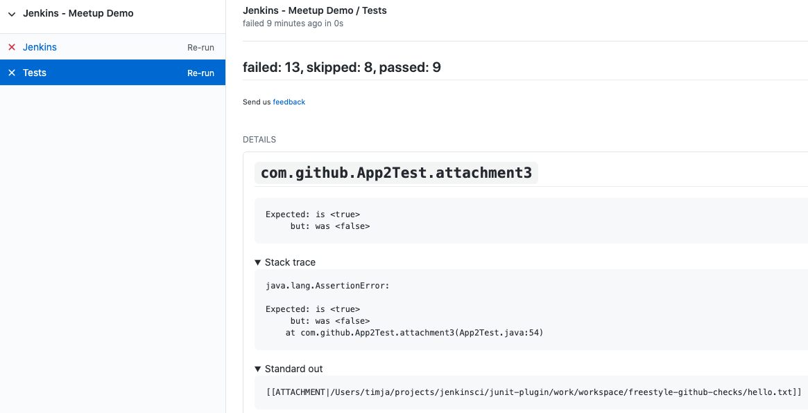

# JUnit Plugin for Jenkins

[](https://plugins.jenkins.io/junit)
[](https://github.com/jenkinsci/junit-plugin/releases/latest)
[](https://plugins.jenkins.io/junit)

The JUnit plugin provides a publisher that consumes XML test reports generated during the builds and provides some graphical visualization of the historical test results 
(see [JUnit graph](https://wiki.jenkins.io/display/JENKINS/JUnit+graph) for a sample) 
as well as a web UI for viewing test reports, tracking failures, and so on. 
Jenkins understands the JUnit test report XML format (which is also used by TestNG). 
When this option is configured, Jenkins can provide useful information about test results, such as trends.

The plugin also provides a generic API for other unit-test publisher plugins in Jenkins. This functionality was part of the Jenkins Core until it was split out to this plugin in version in 1.577.

## Configuration

The JUnit publisher is configured at the job level by adding a Publish JUnit test result report post build action. The configuration parameters include:

* **Test report XMLs:** Specify the path to JUnit XML files in the Ant glob syntax, such as `**/build/test-reports/*.xml`. 
  Be sure not to include any non-report files into this pattern. 
  You can specify multiple patterns of files separated by commas. 
  The base directory of the fileset is the workspace root.
* **Retain long standard output/error:** If checked, any standard output or error from a test suite will be retained in the test results after the build completes. 
  (This refers only to additional messages printed to console, not to a failure stack trace). 
  Such output is always kept if the test failed, but by default lengthy output from passing tests is truncated to save space. 
  Check this option if you need to see every log message from even passing tests, but beware that Jenkins's memory consumption can substantially increase as a result, even if you never look at the test results!
* **Health report amplification factor:** The amplification factor to apply to test failures when computing the test result contribution to the build health score. 
  The default factor is 1.0. A factor of 0.0 will disable the test result contribution to build health score, and, as an example, a factor of 0.5 means that 10% of tests failing will score 95% health. 
  The factor is persisted with the build results, so changes will only be reflected in new builds.
* **Allow empty results:** If checked, the default behavior of failing a build on missing test result files or empty test results is changed to not affect the status of the build. 
  Please note that this setting make it harder to spot misconfigured jobs or build failures where the test tool does not exit with an error code when not producing test report files.
* **Skip publishing checks:** If this option is unchecked, then the plugin automatically publishes the test results to corresponding SCM hosting platforms.
  For example, if you are using this feature for a GitHub organization project, the warnings will be published to
  GitHub through the Checks API. If this operation slows down your build, or you don't want to publish the warnings to
  SCM platforms, you can use this option to deactivate this feature.
* **Checks name:** If provided, and publishing checks enabled, the plugin will use this name when publishing
  results to corresponding SCM hosting platforms. If not, a default of "Test" will be used.
* **Skip marking build unstable:**  If this option is unchecked, then the plugin will mark the build as unstable when it finds at least 1 test failure.
    If this option is checked, then the build will still be successful even if there are test failures reported.
    The corresponding pipeline node (and stage) will still be marked as unstable in case of test failure, unless `skipMarkingStageUnstable` is also set.
    In order to enable this, set the property: 
    `skipMarkingBuildUnstable` to `true`:
    
      junit skipMarkingBuildUnstable: true, testResults: 'test-results.xml'
* **Skip marking stage unstable:** If this option is unchecked, then the plugin will mark the pipeline node (and stage) as unstable when it finds at least 1 test failure.
    If this option is checked, then the test failures will still be reported, but no warning is attached to the pipeline node. Neither the stage nor the build will be marked as unstable.
    Checking this option effectively implies `skipMarkingBuildUnstable: true`.
    In order to enable this, set the property:
    `skipMarkingStageUnstable` to `true`:

      junit skipMarkingStageUnstable: true, testResults: 'test-results.xml'
      
### Test result checks (for GitHub projects)

:warning: This feature requires:
* the installation of an additional plugin: [GitHub Checks Plugin](https://github.com/jenkinsci/github-checks-plugin)
* the configuration of GitHub App credentails, see [this guide](https://docs.cloudbees.com/docs/cloudbees-ci/latest/cloud-admin-guide/github-app-auth) for more details.

If not disabled in the job configuration, this plugin will publish test results to GitHub through [GitHub checks API](https://docs.github.com/en/rest/reference/checks).

In the *Details* view of each check ([example](https://github.com/timja-org/junit-attachments-test/pull/4/checks?check_run_id=1237630805)), test results will be displayed.



In order to disable the checks feature, set the property `skipPublishingChecks` to `true`:
```groovy
junit skipPublishingChecks: true, testResults: 'test-results.xml'
```

The plugin will default to using the stage name or branch of a parallel step prepended by `Tests` for the checks name.
If there are no enclosing stages or branches, `Tests` will be used. The name can also be overridden by a `withChecks` step.

The following snippet would publish three checks with the names `Tests / Integration`, `Tests` and `Integration Tests`, respectively.

```groovy
stage('Integration') {
  junit 'test-results.xml'
}

junit 'more-test-results.xml'

stage('Ignored') {
  withChecks('Integration Tests') {
    junit 'yet-more-test-results.xml'
  }
}
```

### Open Test Reporting (JUnit Platform)

The plugin also reads reports in the [Open Test Reporting](https://github.com/ota4j-team/open-test-reporting) format
written by the [JUnit Platform](https://docs.junit.org/current/advanced-topics/junit-platform-reporting.html#open-test-reporting)
(`open-test-report.xml`), in both its event-based and hierarchical forms.
They are detected automatically, so they can be mixed with legacy JUnit XML reports in the same `junit` step:

```groovy
junit 'target/surefire-reports/**/*.xml'
```

Each test class becomes a suite named after the class, as with the legacy reports, so test history carries over.
Unlike the legacy reports, parameterized, repeated and dynamic tests keep the name of the method they belong to,
e.g. `add(int, int) > [1] 1, 2`. With `keepProperties`, report entries (`TestReporter.publishEntry`), tags and file
attachments are kept as test properties: report entries under their keys, tags as `tags` and attachments as
`attachment.1`, `attachment.2` and so on. A report entry whose key is one of those is kept as `data.<key>`.

With `archiveAttachments`, files attached to tests (`TestReporter.publishFile`) are archived as build artifacts under
`test-attachments/` and linked from the page of each test:

```groovy
junit archiveAttachments: true, testResults: 'target/surefire-reports/**/*.xml'
```

They are archived through the configured artifact manager, like `archiveArtifacts`, so they also work with cloud
storage such as the Azure or S3 artifact managers. Only files inside the directory of their report (and the
workspace) are archived.

#### Streaming test results

With JUnit Platform 6.1 or later, tests can stream their results to Jenkins while they run, without writing report
files, using the `withOpenTestReporting` step:

```groovy
withOpenTestReporting {
    sh 'mvn -B test'
}
```

* Results can be followed live from the *Live Test Results* link of the build.
* When the block ends (whether or not it succeeded), the results are recorded as if by `junit`, which accepts the same
  options (except the report pattern) and returns the same summary. Unlike `junit`, properties are kept and attachments
  are archived by default; use `keepProperties: false` or `archiveAttachments: false` to turn that off.
* If a test JVM crashes or is killed, the results received so far are kept and the tests that were running are
  reported as failures.

The step listens on a socket on the loopback interface of the agent, so the tests must run in the same network
namespace as the agent process: being on the same machine is not enough when they run in a separate container, such as
with `docker.image(…).inside` without `--network host`.
`org.junit.platform:junit-platform-reporting` must be on the test runtime classpath.
Attached files are not part of the stream: test JVMs write them to their JUnit output directory
(`junit.platform.reporting.output.dir`, by default `target` or `build`), and when the block ends they are looked up in
the workspace by their relative path, ignoring files older than the block.
By default, the JUnit configuration parameters that turn streaming on are added to the `JAVA_TOOL_OPTIONS` environment
variable, so no change to the build is needed. To configure it yourself instead, use `javaToolOptions: false` and pass
the port from the `JUNIT_OTR_SOCKET_PORT` environment variable:

```groovy
withOpenTestReporting(javaToolOptions: false) {
    sh 'mvn -B test -Djunit.platform.reporting.open.xml.enabled=true -Djunit.platform.reporting.open.xml.socket=$JUNIT_OTR_SOCKET_PORT'
}
```

## Contributing

Refer to our [contribution guidelines](https://github.com/jenkinsci/.github/blob/master/CONTRIBUTING.md)
